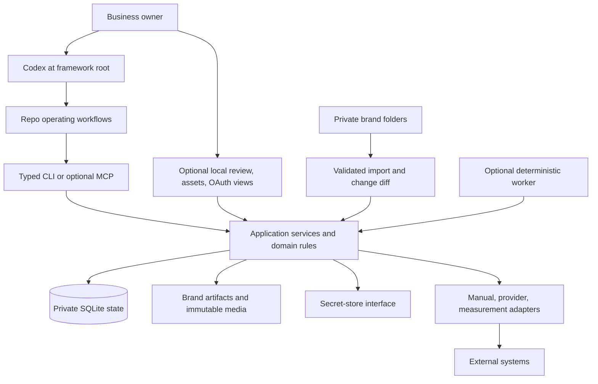
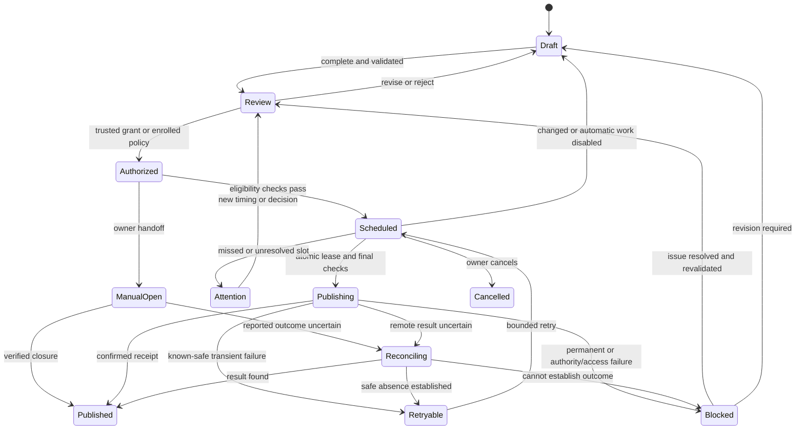

# Architecture and operating contracts

Proposed implementation, October 13, 2026. Tool names and paths below define software to build; they are not installed commands.

## 1. System boundary

Use a local TypeScript application, SQLite, ordinary brand folders, a CLI, and a small optional worker. Codex supplies reasoning, research, writing, creative direction, and interpretation. Deterministic services own validation, transactional state, rendering, authority, external execution, and calculations.



No separate required model API, general CRM, vector database, public account system, Redis queue, or distributed workflow engine. Add infrastructure only for a demonstrated requirement.

## 2. Distributable framework and private workspace

```text
AGENTS.md                         # Existing generic entry guidance
prompts/                          # Existing instruction-only CMO procedures
.agents/skills/                   # Future packaging of the same procedures
  marketing-onboard/
  marketing-strategy/
  marketing-research/
  marketing-campaign/
  marketing-concept-evaluation/
  marketing-review/
  marketing-learn/
apps/
  cli/
  local-ui/
  worker/
  mcp/                            # Optional transport
packages/
  domain/
  application/
  storage-sqlite/
  brand-packages/
  media/
  connectors/manual/
  observability/
  secret-stores/
schemas/                          # Versioned public contracts
examples/brands/harbor-repair/     # Fictional public fixture
templates/brand/                  # Public owner-input template
templates/research/               # Existing research/evaluation record templates
brands/<business>/                # Private inputs, assets, strategy, work, reports
.marketing/                       # Private installation/config/DB/locks
private/                          # Private archives/raw captures
```

Each file/module has a focused responsibility. Do not create every future connector package in advance. A connector implementation depends on application interfaces; business policy never depends on one provider's containers or fields.

Codex reads project instructions and supports repo-scoped skills under `.agents/skills`. Package focused workflows with progressive disclosure; keep the initial operating brief compact. The clone is opened at its trusted framework root, not inside arbitrary imported customer documents. [Official project instructions](https://developers.openai.com/codex/guides/agents-md), [Official skills documentation](https://developers.openai.com/codex/skills)

MCP is optional. The CLI is sufficient for the local Codex workflow, and both transports call the same services. Local STDIO avoids a mandatory exposed service; remote MCP is a separate security/deployment decision. [Official MCP documentation](https://developers.openai.com/codex/mcp)

## 3. Bootstrap and capability negotiation

Planned setup flow: verify supported runtime and lockfile → create private installation identity/config → initialize versioned database → doctor → onboard synthetic fixture → create local export. No installer autostart, account sign-in, recurring Codex task, or external write.

Doctor reports required versus optional capabilities: local filesystem, runtime/SQLite, renderer, research tools/network, image generation, trusted review interaction, OS secret store, available connectors, worker/notice route, and local Codex scheduling. It must inspect actual availability, not infer it from the author's environment.

Support target: macOS and Linux for the first runtime release, with tested versions pinned then; Windows remains unverified until its acceptance run passes. Secrets use an interface with target Keychain/Secret Service adapters. If secure background access is unavailable, only the affected publishing capability is disabled; drafting and export remain usable.

Unknown tool capacity, an exhausted Codex plan, or unavailable network preserves partial artifacts and a clear resume record. There is no automatic paid-model fallback.

## 4. Source of truth, imports, and versioning

[Brand workspace contract](brand-workspaces.md) defines the source-package layer. Original owner files are evidence. SQLite is authoritative for reviewed facts, decisions, campaign/content versions, grants, jobs, and receipts. Markdown/CSV/JSON snapshots are portable output, not a competing mutable database.

Imports calculate source digests and show differences/conflicts. Unchanged imports are idempotent. Material changes mark affected claims and future content stale; the execution eligibility check blocks stale dependencies even if a previous export still exists. A manually edited generated snapshot requires an explicit validated reimport; it cannot overwrite current state silently. Final execution rehashes relevant local dependencies or uses a policy-bounded fresh inventory; changed, missing, or unreadable dependencies hold work even if no Codex refresh ran. Remote sources use separately declared freshness/expiry evidence, without pretending every URL is checked continuously.

Version these contracts independently: framework release, package schema, database schema, export format, connector API, rendering/template version, brand/context revision, content version, and policy version. Unsupported versions fail with a recoverable diagnosis. Never migrate the database inside a publish attempt.

## 5. Domain records

Every brand-owned row requires `brand_id`. Cross-brand reads are explicit portfolio operations; exports and normal tool context stay scoped. Foreign keys plus service checks prevent attaching another brand's private asset, connection, or grant.

| Record group | Essential data |
| --- | --- |
| Installation/workspace | Unique identities, schema version, execution suspension, active worker ownership |
| Brand/package | Stable brand ID, folder binding, package revision, source inventory, locale/timezone |
| Context | Immutable revisions of facts, claims, voice, audiences, proof, preferences, constraints |
| Sources/assets | Origin, digest, observed/verified date, rights, availability, private/public state, dependencies |
| Research run/evidence | Decision question, plan/search log, inclusion/exclusion, access/publication status, methods/outcomes, findings/transfer/limits, source revision, counterevidence, stop reason |
| Corpus/theme | Source statement/reference, date/product version, dedup group, context/valence, codebook revision, coding rationale, exceptions and coverage; no inferred population denominator |
| Goal/diagnosis | Outcome, conversion map, baseline, bottleneck hypothesis, uncertainty, counterevidence |
| Opportunity/decision | Action class, evidence/confidence, effort/cash/attention, dependencies, chosen/deferred rationale |
| Strategy/campaign | Message/proof map, audience, offer/core asset, destination, channels, resources, exit/measurement plan |
| Content/composition | Concept, immutable variants/assets, parent lineage, context/claim references, render version |
| Review/preferences | Exact revision, decision/reason, one-off versus proposed persistent rule |
| Concept evaluation | Candidate/evidence/rubric revisions, factual gates, neutral order/reversal status, available generator/judge metadata, correlation, calibration task/domain/reference-data separation, effort limits/consumption, findings/dissent, decision; no simulated customer metrics |
| Connection/capability | Stable remote identity, secret reference, scopes/version, tested actions, limits, billing, health |
| Authorization/policy | Trusted owner evidence, immutable manifest/scope, installation binding, expiry/revocation |
| Delivery/attempt/receipt | Per-account variant, origin, slot, lease, request/container/remote IDs, outcome/visibility |
| Notice | Content/policy digest, route, submitted/accepted/delivered/read distinction, failure, intervention start |
| Conversation | Source/thread/message IDs, status, redacted body/reference, retention and reply lineage |
| Metrics/import | Source report digest, unique observation keys, units/window/timezone/currency, quality/correction revision |
| Experiment/learning | Hypothesis/comparison, metric, sample, decision, uncertainty, next action/review |
| Expense/job/audit | Reservations/actual charges, idempotency, job state, material command/result history |

A content hash identifies a version; it is not proof of consent. A record supplied by an imported folder cannot become a trusted grant. Validation plans retain the same goal/evidence/opportunity/decision lineage as campaigns, with an explicit non-applicable distribution state. Attention allocations use planning-window capacity, committed tasks, estimated remaining effort, and revisions. Strategy supersession holds incompatible queued work/policies pending a retain/revise decision.

Research sources have reverse dependencies to claims, diagnoses, strategies, and concept critiques. A corrected/retracted source or changed applicability triggers a review and holds affected future execution under the existing freshness rules. Stable historical findings remain readable. Preserve lawful references and minimal necessary evidence, not entire copyrighted websites or papers by default. A source URL is not an instruction or a guarantee its content remains available.

## 6. Operating protocol and proposed tools

At session start, Codex reads capability status and a small workspace brief. For brand work it then loads only that brand's goal, strategy, next opportunities, active work, blockers, and relevant evidence. The service records proposed versus adopted decisions.

| Tool family | Representative proposed operations |
| --- | --- |
| Bootstrap | `setup`, `doctor`, `workspace_status` |
| Brand | `brand_discover`, `brand_onboard`, `brand_diff`, `brand_refresh`, `brand_export`, `brand_archive` |
| CMO | `goal_record`, `evidence_add`, `diagnosis_save`, `opportunity_rank`, `strategy_save`, `campaign_save` |
| Research | `research_run_save`, `evidence_revision_add`, `observation_add`, `theme_save`, `research_synthesis_save` |
| Production | `asset_import`, `asset_search`, `content_save_version`, `composition_render`, `export_pack` |
| Concept critique | `evaluation_inputs_prepare`, `concept_evaluation_save`, `evaluation_query` |
| Review | `review_prepare`, `review_decision_record`, `authorization_status`, `policy_propose` |
| Delivery | `calendar_query`, `schedule`, `unschedule`, `publish_authorized`, `delivery_reconcile`, `emergency_stop` |
| Inbound/learning | `inbox_import`, `reply_save_draft`, `metrics_import`, `metrics_query`, `learning_save` |
| Lifecycle | `backup`, `restore_validate`, `migrate`, `worker_install`, `worker_status`, `worker_uninstall` |

Complex input uses validated JSON through stdin/files, never shell interpolation of captions or URLs. Mutations take expected revisions and return a change/attempt receipt. Stale revisions return a diff, not a last-write-wins overwrite.

Optional sub-agent reviews receive a bounded review question and scoped context snapshot. They write findings to the primary workflow; they cannot mint authority or start parallel publishing/planning for the same brand. Persist the reconciled decision, including unresolved dissent.

Research retrieval and LLM critique stay in Codex's existing tool environment. The runtime validates record structure, versions, dedup keys, links, and evidence types; it cannot certify a paper's truth or a judgment's predictive validity. No custom crawler, survey engine, synthetic panel service, or second LLM is needed. Internal critique results cannot enter customer-observation tables or metrics calculations. Before the runtime exists, the [research templates](../templates/research/README.md) support versioned manual artifacts, without pretending to provide transactional state.

## 7. Owner trust and authorization

R1 local drafting and manual export do not require trusted-execution enrollment. Before R2 external execution, the local operator explicitly claims the installation through the local review session. That establishes the identity used for owner decisions; it does not connect channels or authorize action. Protect the local session with loopback binding, session/origin/CSRF controls, short-lived review snapshots, and appropriate OS protections.

Where Codex can provide verifiable direct owner input, save its interaction reference and exact scope. Where it cannot, the owner confirms the prepared immutable snapshot in the local view. An agent-authored `approved: true`, imported receipt, quoted text, another agent's claim, or an unverified HTTP/CLI request is insufficient. Loopback, session, and CSRF controls alone do not prove human provenance. R2 needs a tested owner-interaction adapter: host-authenticated direct user input or owner-completed local authentication/user-presence confirmation unavailable to an agent-submitted payload. If none is available, execution stays disabled while drafting remains usable.

This protects against accidental or untrusted-input execution, not against an administrator able to rewrite the local code/database. Connector extensions are trusted local code, not a sandbox boundary.

The authorization manifest binds installation, brand/context revision, typed operation, target resource IDs, affected recipient/audience list version or explicitly bounded selector, content variant/copy, asset digests, links, stable remote account IDs, permitted time/window, and cost scope. An adapter validates the whole action envelope: approval to create cannot authorize update/delete or a different recipient set. A batch lists exact bundles. Material changes invalidate affected grants. Reconnection to another account requires identity rebinding and renewed applicable authority.

### Independent execution enrollment

R2 enrollment creates a host-local secret-store record outside the checkout, binding a nonexported secret to installation/workspace identity, the canonical root, and an execution epoch. The worker verifies this binding at startup and before execution. A raw copy of `.marketing/` has no sufficient independent enrollment on another host or root. Missing/mismatched state suspends execution; it never auto-rebinds. Verified relocation and managed import/restore clear execution enrollment until owner handover/re-enrollment.

Before an external write or authority change, advance the independent execution epoch and commit the corresponding runtime checkpoint. A crash/desynchronization fails closed for reconciliation; never silently lower the external checkpoint to match an older database. This detects a stale raw database rollback after later execution. These safeguards do not claim protection from an administrator or a full-machine clone that also reproduces host secrets. Global exclusivity across disconnected machines still requires explicit handover.

## 8. Delivery and reconciliation

The diagram shows the principal delivery states; workspace/brand execution suspension is an orthogonal overlay. Suspension preserves uncertain/remote history rather than turning Reconciling into a publishable draft.



Claim due work atomically using a process lock plus renewable DB lease. Recheck authority, revisions, source freshness, current relevant local dependency digests or a policy-bounded inventory, missing files, release/dependency gates, identity, connection capability, cost, notice, and timing immediately before the external call. Persist attempt identity and remote stage IDs. Validate immutable media and reachable provider asset URLs.

Use documented provider idempotency where available. There is no universal exactly-once guarantee. Ambiguous results stop for reconciliation; when safe absence cannot be established, require manual resolution. Successful sibling destinations are never retried.

Manual delivery is an execution path with a closure record: owner-reported URL/account/time and actual final version, followed by verification when possible. If the final copy differs, preserve an actual-publication version and mark mismatch. An open manual handoff holds competing automatic work until resolved. Remote edits/deletions update observed state without deleting history or triggering reposts.

Record provider-managed mirroring separately from standalone delivery. Choose one route for a mirrored destination. A parent calendar item derives partial/complete state from its deliveries.

Revocation cannot undo an external request already in flight. Stop pending work, surface the uncertainty, reconcile, and present a separately authorized remote removal action if supported.

## 9. Planner, worker, and Autopilot lifecycle

Preparation and execution are independent switches. A rolling plan can contain research, conversion work, or drafts as well as posts. A standing policy narrows to specific content/accounts/windows/resources; it cannot self-expand.

A pre-publication notice begins its window after accepted submission to the configured transport, not after a preview file is saved. Acceptance is not proof of delivery or reading. Known failure/unknown submission holds execution; material changes require a new window or exact approval. Default twenty-four-hour notice is a proposed policy choice.

Worker install/start/pause/status/uninstall are explicit operations with one service identity per workspace. No timer is created during package install. A recurring Codex preparation task is registered only after verifying host scheduling and owner scope; record its identity to prevent duplicate jobs. Local reasoning needs the computer/app and permissions available. [Official scheduling](https://developers.openai.com/codex/app/automations)

On sleep/wake, default grace for approved evergreen work is thirty minutes; beyond it, move to attention instead of burst-posting. Event work expires at its own deadline. Resolve DST ambiguity explicitly. Workspace relocation pauses owned services until paths are validated.

Uninstall first disables new claims and known owned planners/timers, then stops the worker and waits/reconciles only already in-flight attempts; it never drains queued work by publishing it. It removes local account bindings as selected and leaves business data unless deletion is separately chosen. If an external timer cannot be reached, report it as unresolved and keep the local queue suspended; never claim complete cleanup.

## 10. Connector contract

A versioned adapter declares descriptor/version, action/account-specific capabilities, configuration schema, authentication/identity/health, validation, preparation, execution, status/reconciliation, optional metrics/inbox, cost quote, and disconnect behavior.

Return common categories: validation, authority, account mismatch, authentication/expired, permission/provider approval, rate limit, transient safe failure, uncertain write, permanent provider failure, unsupported capability, and quota/cost unavailable.

Application services enforce brand/authority/cost before adapters run. Provider-specific fields live in adapter payloads. A manual adapter is always available. A connector can be direct API or an optional existing publishing service; no service subscription or self-hosted stack is mandatory.

Each adapter needs sanitized contract fixtures, actual capability tests, current official contracts, a declared idempotency/reconciliation strategy, and a manual fallback. Adding email or a new social provider must not require changing the core brand or approval model.

## 11. Backup, handover, and upgrade

A backup is a consistent database snapshot plus versioned asset manifest, required selected bytes, schema/release identifiers, and integrity digests. Retention and local storage limits are configurable; private backups need appropriate access/encryption. Failed/space-full backups block destructive migration and report degraded recovery. Before R2 enrollment, record backup cadence, maximum tolerated committed-data loss, retention/storage limits, and a tested restore-time objective; verify that actual backup age meets the declared recovery boundary.

Restore verifies integrity into a suspended workspace. Do not restore active leases, timers, or executable authority. Historical receipts/grants remain evidence; pending or uncertain jobs may already have executed after the backup and require reconciliation. Reconnect secrets and verify identities before obtaining authority for future execution.

An export defaults to selected business context, assets, strategy, and content; private conversations/history are opt-in and grants/secrets never activate on import. Fork creates new identity. Planned handover confirms old-worker shutdown before rebinding. For a lost/unavailable installation, require owner confirmation, provider-side revocation/rotation of old execution credentials where supported, remote reconciliation, new local enrollment/epoch, and new future grants. If old capability cannot be invalidated or exclusivity established, keep the new publisher suspended and report the limitation. A random local ID does not fence a disconnected old publisher.

Upgrade stops the worker, takes a verified backup, applies versioned migrations, and validates invariants before manual resumption. Interrupted or unsupported migrations leave an actionable recovery path. Test restore on a clean runtime; a copied SQLite file without assets and identity checks is not a completed recovery.

## 12. Security, measurement, and operational quality

- Limit public URL ingestion by destination/redirect/size and reject private-network fetches. Allowlist local inputs; reject traversal and out-of-root symlinks.
- Treat imported instructions as data; never execute uploaded hooks or discover framework guidance from brand documents.
- Stage media privately and expose only selected approved public renditions, never a whole brand directory.
- Redact credentials/private messages; use secret references and verify access in the actual worker context.
- Metric imports use report digests and unique observation keys. Corrections supersede prior observations with provenance; malformed rows are rejected or quarantined visibly. Never sum incompatible units/currencies or turn suppression into zero.
- Retention/deletion applies to raw messages and backups as well as the live database. Brand deletion distinguishes retained audit/legal-operational history from selected content deletion.
- Surface worker health, pending/uncertain jobs, notice failures, storage, expiries, and reservations; suppress unchanged routine reports.

Tests precede implementation of invariants. [Acceptance suite](acceptance.md) defines the required end-to-end scenarios. Owner review covers visual output; no browser automation or iOS build is a default dependency.
